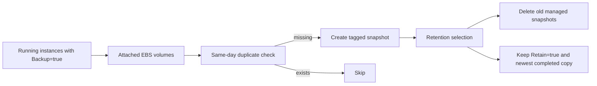

# Design document: EBS snapshot backup and retention

## Problem

Running EC2 instances tagged `Backup=true` need daily EBS snapshots. The automation must avoid duplicate same-day backups and remove only its own old snapshots while protecting retained and newest copies.

## Goal

Provide a Bash and AWS CLI workflow with a dry-run mode, scoped permissions, failure handling, and mocked tests.

## Design



- The script inventories instances and managed snapshots before making changes.
- Every created snapshot receives `CreatedBy`, `BackupDate`, and `SourceInstanceId` tags.
- A same-day pending or completed snapshot prevents a duplicate.
- Retention only considers snapshots created by this automation.
- `Retain=true` and the newest completed snapshot per volume remain protected.
- A backup failure stops retention so the run does not delete while its inventory is incomplete.

## Verification

```bash
bash -n ebs-snapshot-backup.sh
bash tests/test-backup.sh
```

The test replaces the AWS CLI with a mock and exercises creation, duplicate prevention, dry-run safety, retention guards, and failure paths. No live snapshot is created or deleted.

## Risks and limits

Snapshots are created one volume at a time, so the script does not promise crash consistency across an instance. Production use should add scheduling, alerting, cross-region copies, encryption-key permissions, and a tested restore procedure.

